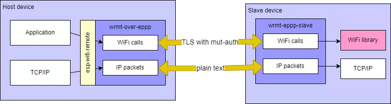

# C++ Reflection, practically (1/2)

```
    █▀▀▀▀▀█ █▄▄▀█▄█▀▀▀█ ▄▄█ ▀▄  ▄ █▀▀▀▀▀█       // https://github.com/david-cermak/zigbee-remote
    █ ███ █   █▀▀ █▀ █▄▀ █▄ ▀██▄  █ ███ █       // blob/main//docs/cpp_meetup_oct26/talk.md
    █ ▀▀▀ █ █▀▀█ ▀▀ ▄▀▄ ▄ █ ▄ ▀ █ █ ▀▀▀ █
    ▀▀▀▀▀▀▀ █ █▄█ █ █ ▀ █ █▄█ █▄▀ ▀▀▀▀▀▀▀
    ▀█▀▄ ▀▀▄▀▀█  ██▄█ ▄▄█  ▄█  ▄█▀█▀▀ ▄██
    ▄   █▀▀▀▀▄▄▀ ▄ ██▀▄█▄▀█▀█ ▄▀ ▄▄▄█▀ ██
      ██▀ ▀▄██▀▀█▀ ▄▀ ▄ ▄▄ ▄█  ██ ██ █▄██
     ▀ █▄▄▀ ▀█▀▄█▀██ ▀▀▀▀▀██▀ ▀▀▄ ▀▄▄   ▀
    ▀ ▀█  ▀▄▀▀▄  ██▄██▄█▄▄ ██  ▄█ ██ █▄██
    ▀▄▀▀▀▄▀▀▀ █▀ ▄ ▀█ ▄▀▀  █▄▀▄█▀█▀  ▄  ▀
    ▀▄▀▀▄▄▀▄ ▀█▀█▀ ▄█▄ █▄▄▀▄▀  █▄▄██ █ ▄█
    ▄█  ▀▀▀█ █▀▄█▀█▀  ▄█  ▄▀▄▀▄▀▄ ██▄▄  ▀
    ▀▄██▄ ▀█ █   ████  ██▄▀██▄▀██ █▀ ▀▄▄█
    ▀▀ ▀ ▀▀ ▀▄█▀ ▄ ▀█ ██▄ ▄▀█▀▄█ █ ▀ ▄▀ ▀
    ▀▀▀ ▀ ▀▀█▄█▀█▀ █▄ ▄▄▀  █▄ ▄▀█▀▀▀█▄ ▀▄
    █▀▀▀▀▀█ ▄█▄▄█▀██▄▀ █ ▀ █▄ ▀▄█ ▀ ██▀ █
    █ ███ █  ▀█  ██▄▀ ██▄▄ ▄█  █▀█▀▀█▀▄▄▀
    █ ▀▀▀ █ ██ ▀ ▄ ██ ▀█  ▄▀▄▀▄ ▄█ ▄▀█▀ ▀
    ▀▀▀▀▀▀▀ ▀▀▀▀▀▀ ▀  ▀▀▀   ▀  ▀▀▀▀ ▀   ▀
```

---
# C++ Reflection, practically (2/2)

* About C++26 Reflection
* Project intro
* **Code**
  - wire-safe
  - auto dispatch
  - auto catalog
* Practical consideration

---

# Constexpr Practically (1/2)
<!-- *Before we start with reflection* 
very nice case study in using the type system, constexpr, fixed-size containers and compile-time computation to make low-level cryptographic code safer without turning it into a heavyweight abstraction framework.
-->
https://github.com/itzmeanjan/ml-kem by **Anjan Roy**
Using **constexpr** and **fixed-size containers** in low-level crypto code
```
    █▀▀▀▀▀█  █▄▀ █▄█▄▀▀▀▀ █▀▀▀▀▀█
    █ ███ █ █▀▄▀█▀▄▀▀▄ █▄ █ ███ █
    █ ▀▀▀ █ █▀ ██  ▄█ ▀▀▀ █ ▀▀▀ █
    ▀▀▀▀▀▀▀ █▄▀▄█ █▄█ ▀ █ ▀▀▀▀▀▀▀
    █▄▀▀▀█▀  ▀▀ ▄▄▄▀▄▀▄▄█ ███▀▀ ▄
    ▀▄ █▄█▀▀▀▄ ▀▄█▀▀▀ ▀ ▀   ▀▄ ▄
    ▄ █▄▄ ▀▄▀▄ ▀  ▀ ▄█▄█▄▄▄▄▄▀▀ ▄
      █▄ ▄▀▀▄▀ ▄▀ ▄██▀▄▄██▄▄█▀▀▄
    █▀██ ▀▀█▀ ▄ █▄▄  █▄█ █▄█▄▀█ ▄
    █ ▄▀█ ▀███▀ ▄█▀█▄▀█ █▄█▀▀ ▀▄
    ▀ ▀▀▀▀▀ ▄ ▀█▄ ▀ ▄▀▄▀█▀▀▀█▄███
    █▀▀▀▀▀█ ▄ ▀ ▄ ▄██ ▀██ ▀ █▀▀▄
    █ ███ █ █ ▄▄▄ ▄ ▄█▄▄█▀▀▀▀▄█▄▄
    █ ▀▀▀ █ ▀ ▀ ▀▀▀▀█▀▄▀██▀█▀█▀█
    ▀▀▀▀▀▀▀ ▀▀    ▀  ▀▀▀  ▀▀▀ ▀
```
---

# Constexpr, practically (2/2)

https://godbolt.org/z/WYnWxKjjz
Complete ML-KEM-512 round-trip: key generation, encapsulation and decapsulation
<!-- http://localhost:10240/z/oT7o6d -->
```
    █▀▀▀▀▀█ █▄▀  █  ▄ █▀▀▀▀▀█
    █ ███ █  ██▄▀██▄  █ ███ █
    █ ▀▀▀ █ █▄  ▄██   █ ▀▀▀ █
    ▀▀▀▀▀▀▀ █ ▀▄▀ █▄█ ▀▀▀▀▀▀▀
    ███▄ ▀▀▄██▀ █▄▀▄▀▀██▀▄ ██
      ▄▄▄█▀▄▄▄ ▀▀ ▄▀█▄▄▄ █▀ ▀
    ▀▀ ▀██▀ ▄█ ▄▄▄▄█▄ ██   ▄█
    ▀▀█▄█▀▀▀▀▀▀█▄ ▀▀█ ▀▄▄█▀ ▀
    ▀▀▀▀ ▀▀▀▄█ ▀▄▄▀ █▀▀▀█  ▀▄
    █▀▀▀▀▀█ ▄█▀██ ▄▄█ ▀ █  ▄█
    █ ███ █  █ ▄█▀▄███▀▀█ ▄▄
    █ ▀▀▀ █ █ ▄▀  ▄ ▄▀ ██▀ ▀▀
    ▀▀▀▀▀▀▀ ▀▀   ▀  ▀▀   ▀  ▀
```
---

# About C++ Reflection (1/3)

Compile-time feature that lets a program
1) inspect its own structure
2) and generate code
based on those observations without any runtime overhead

```
constexpr std::meta::info type_meta = ^^float;

typename [:type_meta:] my_variable = 3.14f; 
```

---

# C++ Reflection: 1) Read code

https://godbolt.org/z/ToWhjYh8j
Pretty-printing structs in C++
<!-- http://localhost:10240/z/Wze8hh -->
```
    █▀▀▀▀▀█ ▄█▄█▀▄ █  █▀▀▀▀▀█
    █ ███ █ ▀ █▀▀ ▄▀  █ ███ █
    █ ▀▀▀ █ █▀ ▀▄▀▀█▀ █ ▀▀▀ █
    ▀▀▀▀▀▀▀ █▄█▄▀ █ ▀ ▀▀▀▀▀▀▀
    ▀█▄█  ▀▀▄ ▀▄▄▀ ▀▀▄█▀▀ ▀▀▄
    █▄ █▀▄▀█ ▀▀▄▀▄ ▄▄█▄ ▄  ▀▀
    ▀ ▄ █▄▀▀▀▄▄▀██▄  ██▄ █▄▀█
    ▀▄▀ ▄ ▀ █▄▀█▀█ ▄█▄▀▀█ ▀▄▀
    ▀▀ ▀▀ ▀▀▄▀ ██ ███▀▀▀██▀ ▄
    █▀▀▀▀▀█ ▀▄▀ ▄▀▄▀█ ▀ ██▄▀█
    █ ███ █ ▄ ▀█▄▄█ █▀▀███▄
    █ ▀▀▀ █ ▄▀ ▄▄█▄██  ▀▀▄▀ ▀
    ▀▀▀▀▀▀▀ ▀▀ ▀▀▀ ▀▀  ▀   ▀▀
```

---

# C++ Reflection: 1) Write code

https://godbolt.org/z/3PWPT1dEW
Generates vtable: credit Ryan Keane https://github.com/RyanJK5/rjk-duck
<!-- http://localhost:10240/z/PGG8G3 -->
```
    █▀▀▀▀▀█ █▀█▀ █  ▄ █▀▀▀▀▀█
    █ ███ █  ▀▄▀ ██▄  █ ███ █
    █ ▀▀▀ █ ██▄ ▄██   █ ▀▀▀ █
    ▀▀▀▀▀▀▀ █ █ ▀ █▄█ ▀▀▀▀▀▀▀
    █▀█▄▄▀▀ ▀█▀█ ▄▀▄▀▀██▀▄ ██
    ▀▀█▀▄▄▀▀▄▄ ▀█ ▄▀█▄▄▄ █▀ ▀
     ▄▀▄▀ ▀█▀▀ ▀▄▄▄█▄ ██   ▄█
    ▀▀▄█▄ ▀ ▄ ▄▀▀ ▀▀█ ▀▄▄█▀ ▀
    ▀▀▀▀▀ ▀▀▄█▀▀▄▄▀ █▀▀▀█  ▀▄
    █▀▀▀▀▀█ ▄▀██▄ ▄▄█ ▀ █  ▄█
    █ ███ █  ▄▄▀▄ ████▀▀█ ▄▄
    █ ▀▀▀ █ █▄▄▀▀ █ ▄▀ ██▀ ▀▀
    ▀▀▀▀▀▀▀ ▀ ▀▀ ▀  ▀▀   ▀  ▀
```

---

# C++ Reflection: WYT?

🟢 **About time!** C++ needed this for decades.
🔴 **C++ is bloated enough!** Please stop adding features.
👀 **Convince me** Show me a real use case.

--
⚪ Don't care; I'll probably never use it.


---
# Project introduction (1/2)

Wi-Fi RPC between two nodes: **Host** and **Slave**
Host **reflects** (on) Slave's API



---

# Project introduction (2/2)

https://github.com/david-cermak/zigbee-remote
Host (client): PC; Slave (server): Zigbee device
```
    █▀▀▀▀▀█  ▄▀  ▄██ █▀█  █▀▀▀▀▀█
    █ ███ █ ▀▄ ▀▄ ▄█▀ ▄█▄ █ ███ █
    █ ▀▀▀ █  ▀▄▄█▄██▄▄██▄ █ ▀▀▀ █
    ▀▀▀▀▀▀▀ █ ▀▄▀▄█ █▄▀▄▀ ▀▀▀▀▀▀▀
    ▀▀█▄▀▀▀██▄ ▄█▀▀ █▀▀ █▀█  ▄▀ ▄
     ▀▄▀█▀▀▄▀▄█▀█▄▄▄ ▄▄▄█▀▀▄█ ▀█▀
    █▄ ▀▄ ▀▀ ▄██ █▄▀██  ███  █ ▀█
    █ █▄ ▀▀▀▄▀▀▄ █▀ ▀██ ▄▄█ ▀█ █▀
     █▄█▀▀▀█▄▄ ▄██ ▀▄█ ▀▀▄█▀ █▄▀█
    ▀▄█ ▄█▀█▄  ▀█▄▄ ▄▄▄▄▄█▄██▄ █▀
    ▀  ▀ ▀▀ █▄ █▀▀ ▀▀█▄██▀▀▀█ ▄▄▄
    █▀▀▀▀▀█ █  ▄▄▄▄  █▀▀█ ▀ ██ ▀▀
    █ ███ █ ▀█▄ █▀ ▀█▀  █▀▀██ ▄█▄
    █ ▀▀▀ █ █  ▄██▄▄ ▄▄█▄▄ ▀█▀ ▄▀
    ▀▀▀▀▀▀▀ ▀▀▀  ▀  ▀▀ ▀▀▀ ▀▀  ▀▀
```
---

# Code: Wire-safe

https://godbolt.org/z/qa661n4a6
walks members at compile time and rejects host ints, pointers, unions (before anything hits the wire).
<!-- http://localhost:10240/z/q11njW -->
```
    █▀▀▀▀▀█ █▀▀  █  ▄ █▀▀▀▀▀█
    █ ███ █  █ ▀▄██▄  █ ███ █
    █ ▀▀▀ █ ██▄ ▀██   █ ▀▀▀ █
    ▀▀▀▀▀▀▀ █ ▀▄█ █▄█ ▀▀▀▀▀▀▀
    ██▀ ▄▀▀▄██▀▄█▄▀▄▀▀██▀▄ ██
    █▀▄█  ▀▀▀▄ ▀  ▄▀█▄▄▄ █▀ ▀
    ▀▀▄▀ ▄▀▀▀█ █ ▄▄█▄ ██   ▄█
    ▀▀█ ▄ ▀█▀▀███ ▀▀█ ▀▄▄█▀ ▀
    ▀▀ ▀▀ ▀ ▄ ▀█ ▄▀ █▀▀▀█  ▀▄
    █▀▀▀▀▀█ ▄ ▄██ ▄▄█ ▀ █  ▄█
    █ ███ █  ▄▀█  ▄███▀▀█ ▄▄
    █ ▀▀▀ █ █  ▀ ▀█ ▄▀ ██▀ ▀▀
    ▀▀▀▀▀▀▀ ▀▀▀▀▀   ▀▀   ▀  ▀
```
---

# Code: Dispatch by id

https://godbolt.org/z/qdjE4az3o
Consteval helper `id_for_name()` walks enumerators of api id. If the handler name equals an enumerator name, you get that id and we call the handler.
<!-- http://localhost:10240/z/5vcGWo -->
```
    █▀▀▀▀▀█  █  ██  ▄ █▀▀▀▀▀█
    █ ███ █ ▄█▀█▀▄ ▄█ █ ███ █
    █ ▀▀▀ █ ▀▄▄▀ ▄▄ ▀ █ ▀▀▀ █
    ▀▀▀▀▀▀▀ ▀ █ █ █▄█ ▀▀▀▀▀▀▀
    ██▄  █▀█▄█▄▄▀█▄▄▄  ▄██▄▄
    █▀▄▀█▄▀█ ▄▀ ▀▀█▀▄█ █▀█ ▀█
    ▄█▄█▀▀▀█▀▀ █▄▄▄█▄ ▀█   ▄▀
    █ █▄█▄▀▄ ▄▀  ▀▄▀ ▀██▀█▄▀█
    ▀ ▀▀  ▀ ▄   ▀█  █▀▀▀█ ▀
    █▀▀▀▀▀█ █ ███ ▄▄█ ▀ █  ▄▀
    █ ███ █   ▄█▀▀▀█▀██▀▀ ▀█▄
    █ ▀▀▀ █ ▄█▄ ▀ ▄ █ ▄▄▄▀▀ █
    ▀▀▀▀▀▀▀ ▀▀ ▀▀   ▀▀   ▀  ▀
```

---

# Code: Auto catalog

https://godbolt.org/z/8cono9jPx
Same namespace, same enum: a string baked at compile time. catalog dump walks handlers, checks id for name and appends lines: name, id, request type, response type.
<!-- http://localhost:10240/z/TqWTE4 -->
```
    █▀▀▀▀▀█ █▀ ▀ █  ▄ █▀▀▀▀▀█
    █ ███ █  ██▄▀██▄  █ ███ █
    █ ▀▀▀ █ █   ▄██   █ ▀▀▀ █
    ▀▀▀▀▀▀▀ █ ▀ ▀ █▄█ ▀▀▀▀▀▀▀
    ███▄▄▀▀▄▀█▀▄ ▄▀▄▀▀██▀▄ ██
     █ ▄▄▄▀█ ▄ █▄ ▄▀█▄▄▄ █▀ ▀
     ▀▄█ █▀ ▄█ ▄█▄▄█▄ ██   ▄█
    ▀▀▀█▀▄▀▄█ ███ ▀▀█ ▀▄▄█▀ ▀
    ▀▀▀▀▀ ▀ █▄▄▄█▄▀ █▀▀▀█  ▀▄
    █▀▀▀▀▀█ ▄ ▀█▄ ▄▄█ ▀ █  ▄█
    █ ███ █  ▀█▄█▄████▀▀█ ▄▄
    █ ▀▀▀ █ █▀██ ▀▀ ▄▀ ██▀ ▀▀
    ▀▀▀▀▀▀▀ ▀▀ ▀▀   ▀▀   ▀  ▀
```
---

# Practical lessons: Footprint

| C++ hello-world | Flash | RAM |
| --- |--- | ---: |
| + `#include <meta>`/unused | Δ **0** | Δ **0** |
| + `print_object` (no nested types) | Δ **+492** code, **+144** data | Δ **0** |
| + recurse into `Person::SubPerson` | Δ: **+176** code, **+64** data | Δ **0** |
| + runtime dispatch (4 cmds) | Δ: **+544** code, **+240** data | Δ **0** |

You pay for the specializations you use (like a template library)

---

# Practical lessons: CMake detection

```cmake
include(CheckCXXCompilerFlag)

# -freflection is only accepted together with -std=c++26 / gnu++26
set(_saved_flags "${CMAKE_REQUIRED_FLAGS}")
set(CMAKE_REQUIRED_FLAGS "${CMAKE_REQUIRED_FLAGS} -std=gnu++26")
check_cxx_compiler_flag(-freflection HAS_FREFLECTION)
set(CMAKE_REQUIRED_FLAGS "${_saved_flags}")
unset(_saved_flags)
if(HAS_FREFLECTION)
    target_compile_options(${COMPONENT_LIB} PRIVATE
        $<$<COMPILE_LANGUAGE:CXX>:-std=gnu++26>
        $<$<COMPILE_LANGUAGE:CXX>:-freflection>
    )
    target_compile_definitions(${COMPONENT_LIB} PRIVATE HAS_FREFLECTION=1)
endif()
```

---

# Practical lessons: Static analysis

If production does not support C++ 26, you can still 

* build a slice of your classes with GCC 16
* encode your project constraints (just like a semgrep rules, but for C++ types)

---

# Practical lessons: In GCC 16.2

* Results from `members_of` / `parameters_of` are vectors (in a consteval context)
  - Expand via passing through reflect constant array
* `identifier_of` fails on entities without names
  - filter constructors and special members
* C++ empty classes `sizeof()==1`, need `EmptyReq{}` specialization

---

# C++ Reflection: WYT now?

🟢 **Geat feature!**
🔴 **Doesn't belong to C++**
⚪ **Don't care**
